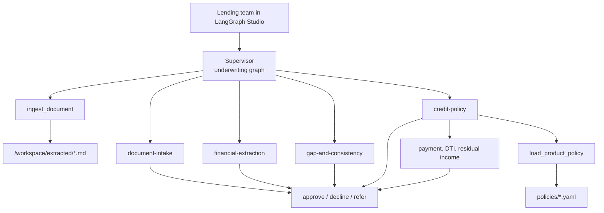

# Underwriting Deep Agent POC

A LangGraph Deep Agent that reviews a loan file for a lending team. It ingests PDF and DOCX packages, classifies documents, extracts cited financials, flags gaps and inconsistencies, runs repayment-capacity tools, and returns **approve**, **decline**, or **refer** with proof.

This is a recommendation aid, not a system of record. Sample policies are illustrative.

## Architecture

The graph is a single [Deep Agent](https://docs.langchain.com/oss/python/deepagents/overview) created in `src/underwriting_agent/graph.py` and registered as `underwriting` in `langgraph.json`. A supervisor owns the conversation. It delegates four specialized subagents and keeps the final recommendation.



### How a review runs

1. The supervisor lists the application folder under `/applications/` and calls `ingest_document` on every PDF and DOCX. Binary files are not read with `read_file`.
2. Ingest writes page- and paragraph-marked markdown to `/workspace/extracted/{stem}.md`.
3. **document-intake** classifies each sidecar (`application`, `government_id`, `pay_stub`, `bank_statement`, `tax_return`, `employment_letter`, `credit_report`, or `other`) and maps it to the product checklist.
4. **financial-extraction** pulls cited facts (income, debts, FICO, loan terms, employment) as `SourceRef` records: file path, page or paragraph, and a verbatim quote. Conflicting documents are both kept.
5. **gap-and-consistency** compares the classified file to `required_document_sets` and flags missing documents, cross-document disagreements, and questions for a human underwriter.
6. **credit-policy** loads the product YAML, runs the calculation tools, and scores each rule.
7. The supervisor returns the recommendation, metrics, per-rule results, gaps, and the quotes that support them.

### Decision rules

| Recommendation | When |
| --- | --- |
| **approve** | Every required document set is satisfied, metrics come from tools, and every policy rule passes with a citation. |
| **decline** | Cited evidence shows a policy failure, such as DTI, FICO, amount, employment tenure, or bankruptcy lookback. |
| **refer** | A required document or calculation input is missing, or a high-severity inconsistency is unresolved. Missing files are not a decline. |

### Filesystem

`CompositeBackend` maps virtual paths onto the repo. The agent may write only under `/workspace/`.

| Virtual path | On disk | Access |
| --- | --- | --- |
| `/applications/` | `data/applications/` | read |
| `/policies/` | `policies/` | read |
| `/skills/` | `skills/` | read |
| `/workspace/` | `data/workspace/` | read and write |
| everything else | agent state | ephemeral |

### Tools

| Tool | Used for |
| --- | --- |
| `ingest_document` | PDF/DOCX text with page or paragraph markers |
| `list_products` / `load_product_policy` | Product registry and YAML rules |
| `amortizing_payment` | Fully amortizing monthly payment (`annual_rate` is a decimal, so 11.9% is `0.119`) |
| `dti` | Housing + existing monthly debt + proposed payment, divided by monthly gross income |
| `residual_income` | Monthly net income minus total obligations |
| `ltv` / `dscr` | Stubs for later products. The sample personal loan does not use them as pass/fail. |

Skills in `skills/` (`underwriting-workflow`, `citation-and-evidence`, `personal-loan-review`) are mounted at `/skills/` and tell the supervisor the order of work and the citation rules.

### Subagents

| Subagent | Tools | Structured result |
| --- | --- | --- |
| `document-intake` | ingest, policy | `DocumentIntakeResult` |
| `financial-extraction` | ingest | `FinancialExtractionResult` |
| `gap-and-consistency` | policy | `GapAnalysisResult` |
| `credit-policy` | policy, calculations | `CreditPolicyResult` |

## Requirements

- Python 3.12+
- [uv](https://docs.astral.sh/uv/)
- An Anthropic API key

## Setup

```bash
uv sync --dev
cp .env.example .env
```

Edit `.env`:

- `ANTHROPIC_API_KEY` — required. Create one at [platform.claude.com](https://platform.claude.com).
- `UNDERWRITING_MODEL` — optional. Default in code is `anthropic:claude-haiku-5-5`. The commented alternative in `.env.example` is `anthropic:claude-sonnet-5-5`.
- `LANGSMITH_API_KEY` and `LANGSMITH_TRACING` — optional, for traces in [LangSmith](https://smith.langchain.com/).

Generate the synthetic Jordan Hale package:

```bash
uv run python scripts/generate_sample_application.py
```

That writes `data/applications/sample-personal-loan/` (application DOCX, government ID, two pay stubs, bank statement, and credit summary).

## Run

LangGraph Studio is the supported runner. The CLI entry only prints this same instruction.

```bash
uv run langgraph dev
```

Studio loads the `underwriting` graph from `langgraph.json` (`./src/underwriting_agent/graph.py:agent`) and reads `.env`. Studio does not mount arbitrary uploads into agent state, so put borrower files on disk first:

```text
data/applications/<folder>/*.pdf
data/applications/<folder>/*.docx
```

Then prompt:

> Underwrite `/applications/sample-personal-loan` against `personal_loan`.

The agent sees that folder as `/applications/sample-personal-loan`. Extracted sidecars appear under `data/workspace/extracted/`.

## Sample personal loan

`policies/products.yaml` registers one product:

| | |
| --- | --- |
| Product | `personal_loan` — unsecured installment loan |
| Rules | `policies/personal_loan.yaml` |
| Narrative | `policies/personal_loan.md` |

Illustrative limits: $1,000–$50,000, 12–60 months, max DTI 43%, minimum FICO 660, at least 6 months with the current employer, no bankruptcy in 24 months.

Required document sets (each inner list is OR, every outer list is AND):

1. Application
2. Government ID
3. Pay stub or tax return
4. Bank statement

The sample borrower is Jordan Hale: $18,000, 36 months, 11.9%, FICO 732.

## Add a product

Keep the same graph. Add a YAML rule file and a markdown narrative under `policies/`, then register both in `policies/products.yaml`. Attach extra calculation tools only if the product needs them. `ltv` and `dscr` are already on the supervisor tool list for that.

## Tests

```bash
uv run pytest
```

Covers policy loading, document ingest, and the payment, DTI, and residual-income calculations.

## Layout

```text
src/underwriting_agent/
  graph.py            Deep Agent entrypoint
  subagents.py        four review subagents
  prompts.py          supervisor and subagent prompts
  config.py           model, paths, filesystem permissions
  models.py           cited facts, issues, and decisions
  tools/              ingest, policy, and calculations
policies/             product registry, YAML rules, narrative
skills/               workflow and citation skills
data/applications/    loan packages (read-only to the agent)
data/workspace/       extracted markdown (writable)
scripts/              sample application generator
```
